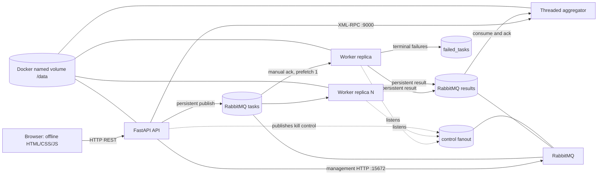

# SimilarDocs architecture

## Component and message topology



`failed_tasks` is a durable diagnostic queue. It is deliberately not consumed by the aggregator, so terminal failures remain inspectable in RabbitMQ. `control` is a durable fanout exchange; each worker creates its own exclusive, auto-delete subscription queue.

## Services and addresses

| Compose service | Responsibility | Address |
|---|---|---|
| `rabbitmq` | Durable task/result/failure queues, control fanout, management API | `rabbitmq:5672` internally; management `rabbitmq:15672` internally / host `localhost:15672` |
| `api` | Dataset generation/upload, preprocessing, REST, task publication, UI | `api:8000` internally / host `localhost:8000` |
| `worker` replicas | Consume block-pair tasks, calculate scores, publish results | Compose DNS name `worker` |
| `aggregator` | Threaded XML-RPC registry, result consumer, integrity and report persistence | `aggregator:9000` internally; not host-published |

All services use Compose DNS names, never hard-coded container IP addresses. The API's DNS endpoint calls `socket.gethostbyname_ex` from inside the API container. The web page is served by the API at `/`; its JavaScript, CSS, and HTML are local files with no CDN dependency. The retained `frontend/` React project is not in this service path.

## Job sequence

```mermaid
sequenceDiagram
  participant B as Browser
  participant A as FastAPI
  participant Q as RabbitMQ
  participant W as Worker
  participant G as Aggregator
  participant V as Named /data volume
  B->>A: POST /api/datasets/generate or /upload
  A->>V: Store doc_*.txt and ground_truth.json
  B->>A: POST /api/jobs
  A->>V: Normalize, shingle, write processed blocks
  A->>G: XML-RPC register_job(...)
  G-->>A: Job registry status + Lamport counter
  loop each unique unordered block-index pair i <= j
    A->>Q: Persistent task (UUID, block indices, attempt, lc)
  end
  Q->>W: Deliver task (prefetch=1)
  W->>G: XML-RPC task_received event
  W->>V: Read preprocessed shingles
  W->>W: Compare document pairs using Jaccard
  W->>Q: Persistent result (matches, pairs_compared, duration, lc)
  W->>Q: Ack task only after result publish confirmation
  Q->>G: Deliver result
  G->>G: De-duplicate by task_id; update completion and pair totals
  G->>V: Atomically save completed JSON report
  B->>A: Poll status/results/timeline
  A->>G: XML-RPC read calls
  G-->>A: Job state and saved results
  A-->>B: REST JSON
```

## Pair partition and integrity

For `N` documents, expected unique document pairs are `N(N−1)/2`; for 200 documents that is 19,900. The API splits the sorted document list into blocks of size `B`, with `M = ceil(N/B)` blocks. It creates one task for every block pair `(i,j)` where `i <= j`, so there are `M(M+1)/2` tasks:

- A diagonal task compares only `k < l` inside its block.
- A cross-block task compares every document in block `i` with every document in block `j`.

These disjoint block-pair regions cover each unordered document pair once. At completion, aggregator integrity reports (1) the number of unique task IDs equals the registered task count and (2) the sum of `pairs_compared` equals `N(N−1)/2`. A deliberately injected poison task is extra and contributes zero pairs; its terminal result causes `completed_with_failures`. Because the normal tasks still cover all document pairs, pair-count integrity remains true for the poison demonstration.

## Similarity algorithm

`common/shingle.py` lowercases the input, removes Unicode punctuation, splits on whitespace, and forms contiguous five-word shingles. Each shingle is joined with a separator and hashed with BLAKE2b using an 8-byte digest. Similarity is Jaccard `|A ∩ B| / |A ∪ B|`; if either set is empty, the score is zero. The score is a textual-overlap signal, not a plagiarism verdict.

The API preprocesses shingle sets into `/data/datasets/<dataset_id>/processed/block-<block_size>.json`. Worker containers read this file from the same named volume; it is shared container storage, **not** a distributed file system. Reported in-progress task counts are derived from fresh worker heartbeats/current-task events, not presented as an authoritative RabbitMQ count. Retry-event counts likewise reflect retry events reported to the aggregator.

## RPC, state, and clocks

The aggregator exposes `register_job`, `mark_submitted`, `log_event`, `worker_heartbeat`, `get_workers`, `get_job_status`, `get_results`, `get_timeline`, `get_time`, and `list_jobs` over internal XML-RPC. Each server method logs its RPC name; the shared client helper logs outgoing calls, applies a timeout, and propagates RPC faults. The threaded server protects mutable registry state with a re-entrant lock.

Job/task state is held in aggregator memory. A completed report is saved as `/data/jobs/<job_id>.json` using an atomic temporary-file replace. The aggregator does not rebuild in-flight state from RabbitMQ after restart; an in-flight job's registry state is lost. There is no SQL/NoSQL database.

Each service has a Lamport clock. Send events tick the sender; receive events use `max(local, remote) + 1`. Worker `WORKER_CLOCK_SKEW_SECONDS` offsets only the timestamp the worker reports, not the machine clock or execution. Both timeline orderings are shown, and the UI labels this as SIMULATED when enabled.

## Delivery, retries, and failures

- Queues and messages are durable/persistent. API and worker publishers use publisher confirms.
- Workers set prefetch to one and acknowledge an input task only after the output result or retry/failure message is confirmed.
- If a worker exits with an unacknowledged task, RabbitMQ can redeliver that delivery. The system promises at-least-once delivery, not exactly-once execution.
- The aggregator ignores duplicate terminal results by task ID.
- An exception causes republish with `attempt + 1` through three retries. On the next exception, the worker publishes a terminal failure to both `failed_tasks` and `results`, allowing the registered job to finish as `completed_with_failures`.
- The opt-in kill control is explicitly simulated. The API requires at least two consumers, one active task reported by a fresh worker, a processing job, and at least one RabbitMQ unacknowledged task before publishing the control.
- API submission and RabbitMQ are not one distributed transaction. If submission partially fails, the API records a submission failure; inspect the task count instead of assuming full acceptance.

## Storage boundaries

Compose named volumes are `similardocs_shared_data_v3` (mounted at `/data` by API, workers, and aggregator) and `similardocs_rabbitmq_data_v3` (RabbitMQ data). Generated reports, datasets, processed metadata, and benchmark imports remain in the named shared volume across ordinary container restarts. No Windows bind mount is used for service data.
